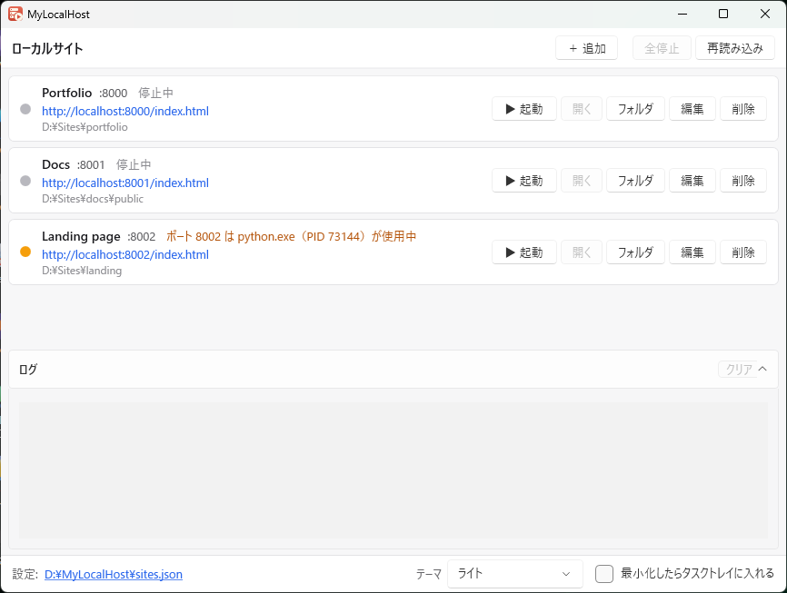
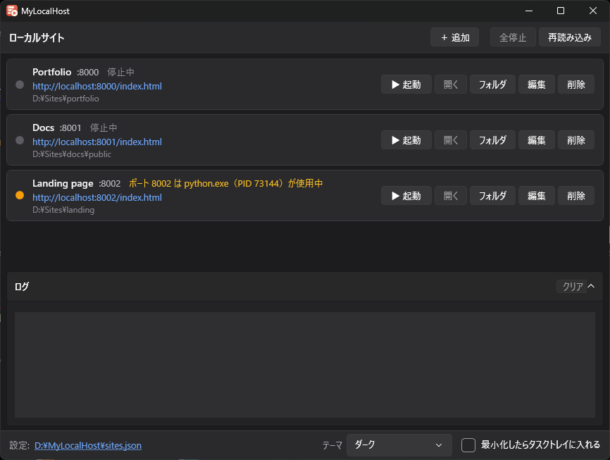

# MyLocalHost

ローカルの静的サイト（HTML / CSS / JavaScript）を、ワンクリックでブラウザ確認するための Windows 用ソフトです。

`cd <フォルダ>` → `py -m http.server 8000` のような手順を毎回打つ代わりに、確認したいフォルダとポートを登録しておけば、
「▶ 起動」を押すだけでサーバーが立ち上がり、ブラウザで開きます。



## できること

- **ワンクリックで起動・停止**：起動するとブラウザで開きます。起動中かどうかはランプの色で分かります。
- **複数のサイトを同時に**：ポートを分ければ、いくつでも並べて動かせます。
- **ポートの使用中を検出**：ほかのソフト（python.exe など）がポートを使っていると、起動前に知らせます。
- **修正がすぐ反映**：キャッシュさせない設定で配信するので、再読み込みで最新のファイルが表示されます。
- **文字化けしにくい**：HTML・CSS・JavaScript などを UTF-8 として配信します。
- **アクセスのログ**：どのファイルが読まれたか、404 になったかを画面の下で確認できます。
- **ダークモード**：Windows の設定に合わせるか、ライト / ダークを選べます。
- **タスクトレイ**：最小化したらタスクトレイに入れることもできます。
- **インストール不要**：exe を置くだけで動きます。設定は exe と同じフォルダの `sites.json` に保存されるので、フォルダごと別の PC に持っていけます。
- **外部からは見えない**：自分の PC（localhost）からのアクセスだけを受け付けます。



## ダウンロード

[Releases](../../releases) から、どちらかの zip をダウンロードして展開してください。

| ファイル | 大きさ | 必要なもの |
|---|---|---|
| `MyLocalHost-<版>-win-x64.zip` | 約 80MB | なし（そのまま動きます） |
| `MyLocalHost-<版>-win-x64-small.zip` | 1MB 未満 | [.NET 10](https://dotnet.microsoft.com/download/dotnet/10.0) の「.NET Desktop Runtime」と「ASP.NET Core Runtime」（どちらも x64） |

迷ったら、大きい方（必要なものなし）を選んでください。

- 対応 OS：Windows 10 / 11（64bit）
- 初めて起動するとき、「Windows によって PC が保護されました」と表示されることがあります。
  コード署名をしていないためです。「詳細情報」→「実行」で起動できます。

## 使い方

1. `MyLocalHost.exe` を起動します。
2. 「＋ 追加」で、名前・フォルダ・ポート・最初に開くページ（例：`index.html`）を登録します。
3. 「▶ 起動」を押すと、ブラウザで `http://localhost:<ポート>/` が開きます。
4. 確認が終わったら「■ 停止」を押します。ウィンドウを閉じると、起動中のサーバーはすべて止まります。

ランプの色の意味：

| 色 | 状態 |
|---|---|
| 緑 | 起動中 |
| 灰 | 停止中 |
| 橙 | 起動できない（フォルダがない、ポートをほかのソフトが使用中など）。理由はランプの横に表示されます |

## 設定ファイル（sites.json）

exe と同じフォルダに作られます。画面下のリンクから、保存フォルダを開けます。

```json
{
  "version": 1,
  "minimizeToTray": false,
  "theme": "system",
  "sites": [
    {
      "name": "My Site",
      "folder": "C:\\work\\my-site\\public",
      "port": 8000,
      "startPage": "index.html"
    }
  ]
}
```

- `theme`：`system`（Windows に合わせる）、`light`、`dark`
- 手で書き換えたときは、画面の「再読み込み」で読み直せます（すべて停止しているときのみ）。

## 自分でビルドする

- 必要なもの：Visual Studio 2026 または .NET 10 SDK
- `MyLocalHost.slnx` を開いてビルドします。
- 配布用の exe は、次のコマンドで `publish` フォルダに作られます。

```bash
dotnet publish MyLocalHost/MyLocalHost.csproj -p:PublishProfile=Portable
```

```bash
dotnet publish MyLocalHost/MyLocalHost.csproj -p:PublishProfile=Small
```

- アイコン（`MyLocalHost/Resources/app.ico`）は `tools/make_icon.py` で作っています（Python と Pillow が必要）。

## 仕組み

- 画面：WPF（.NET 10）
- サーバー：ASP.NET Core の Kestrel をアプリの中で動かしています（Python などは不要です）。
- ポートの確認：Windows の TCP 接続一覧を調べ、待ち受けているプロセス名を表示します。

## ライセンス

[MIT License](LICENSE)

無償で自由にお使いいただけます。個人・商用を問わず、複製・改変・再配布もできます。
本ソフトウェアの使用により生じたいかなる損害についても、作者は責任を負いません。
個別のサポート・お問い合わせ対応は行っておりません。

---

有限会社エナージ — https://enarge.jp/
